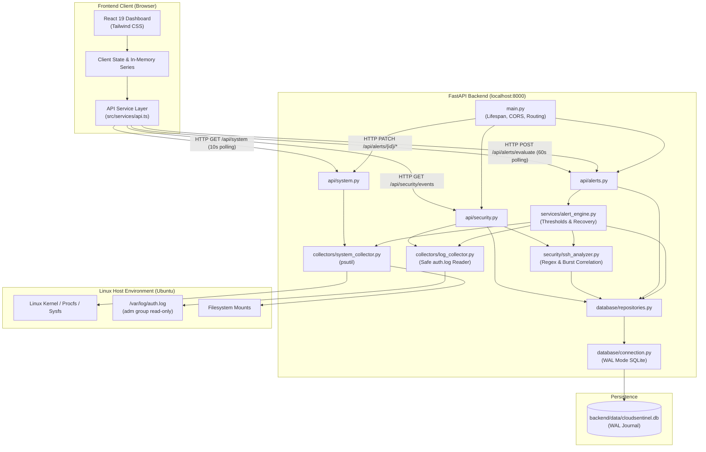
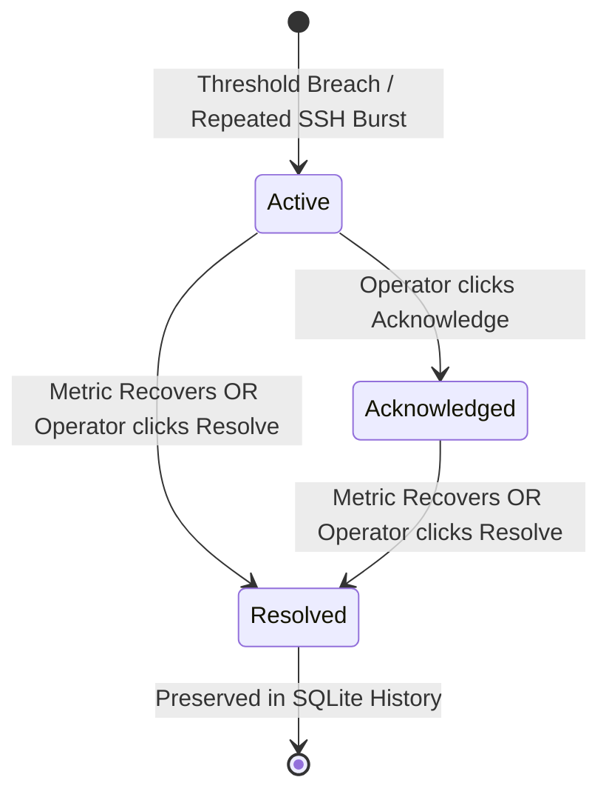

# CloudSentinel Architecture

## Overview

CloudSentinel is a single-host Linux infrastructure and security monitoring platform designed specifically for an Ubuntu server. It operates as a decoupled two-tier architecture:

1. **Backend Service**: A Python FastAPI application providing REST endpoints, interacting directly with the Linux operating system via `psutil` and log collectors, persisting alerts and security events to an embedded SQLite database.
2. **Frontend Dashboard**: A React 19 + TypeScript + Vite single-page application providing real-time data visualization, telemetry charts, log auditing, and alert lifecycle management.

---

## Architectural Diagram

---

## Data Flow

### 1. System Telemetry Pipeline (10-Second Polling)
1. The frontend invokes `GET /api/system` every 10 seconds.
2. `backend/app/api/system.py` calls `get_all_system_metrics()` in `collectors/system_collector.py`.
3. `system_collector.py` calls `psutil` functions (`cpu_percent`, `cpu_count`, `virtual_memory`, `disk_usage`, `net_if_addrs`, `net_if_stats`) and platform libraries to gather live host statistics.
4. The JSON payload is returned to the frontend.
5. In the frontend (`src/services/api.ts` and `src/App.tsx`):
   - Host resource percentages (CPU, RAM, Disk) and deltas are computed.
   - `selectPrimaryNetworkInterface()` scores active network interfaces to prioritize physical Wi-Fi/Ethernet adapters over virtual bridges and loopback.
   - The current CPU reading is appended as a `CpuPoint` to the in-memory `cpuSeries` time-range bucket for dynamic SVG graphing.

### 2. Authentication Event Pipeline
1. On demand or during alert evaluation, `collectors/log_collector.py` opens `/var/log/auth.log` in read-only mode using `collections.deque(maxlen=1000)` to tail the most recent entries without reading the entire log into memory.
2. `security/ssh_analyzer.py` applies regular expressions to identify:
   - Failed passwords for valid users (`Failed password for <user> from <ip>`).
   - Failed passwords for invalid users (`Failed password for invalid user <user> from <ip>`).
   - Sudo authentication failures (`pam_unix(sudo:auth): authentication failure`).
   - Repeated failure clusters: A sliding time window (default 300 seconds) detects burst attempts (≥5 failures from a single IP) and generates a synthetic `repeated_attempt` security event.
3. Each event receives a deterministic unique ID based on an MD5 hash of `(timestamp, source_ip, target_user, category, attempts)`.
4. Events are inserted into the SQLite `security_events` table using `INSERT OR IGNORE` to guarantee idempotent ingestion.
5. `GET /api/security/events` queries SQLite and returns ordered records to the dashboard.

### 3. Automated Alert Evaluation Pipeline (60-Second Polling)
1. The frontend or operator triggers `POST /api/alerts/evaluate`.
2. `services/alert_engine.py` collects live metrics and compares them against configured thresholds:
   - **CPU**: Warning ≥ 75.0%, Critical ≥ 90.0%
   - **Memory**: Warning ≥ 80.0%, Critical ≥ 92.0%
   - **Disk**: Warning ≥ 75.0%, Critical ≥ 90.0%
3. If a threshold is crossed:
   - If an active alert for that source (`system_cpu`, `system_memory`, `system_disk`) already exists, its description and updated timestamp are updated without creating duplicates.
   - If no active alert exists, a new alert record is created with status `'active'`.
4. If a previously alert-triggering metric falls back below the warning threshold, the alert engine transitions the existing open alert to `'resolved'` automatically.
5. `alert_engine.py` also checks recent `repeated_attempt` security events and raises a critical security alert if unhandled bursts exist.
6. The evaluation response returns a comprehensive tally of created, updated, and resolved alerts.

### 4. Alert Lifecycle Management
Operators manage alerts directly from the dashboard:
- `PATCH /api/alerts/{id}/acknowledge`: Transitions status from `active` → `acknowledged`.
- `PATCH /api/alerts/{id}/resolve`: Transitions status from `active` or `acknowledged` → `resolved`.
- Transitioning an already resolved alert to acknowledged is rejected (`400 Bad Request`).
- Once resolved, alerts remain stored in the SQLite database for audit history.

---

## Module Responsibilities

| Layer | Module | Responsibility |
|---|---|---|
| **Frontend** | `src/App.tsx` | Main controller. Manages dashboard views, intervals (10s telemetry, 60s alert evaluation), error handling, and offline banners. |
| **Frontend** | `src/services/api.ts` | Centralized typed HTTP client with response validation, error translation, and network interface priority scoring. |
| **Frontend** | `src/components/MetricCard.tsx` | Visual gauge for CPU, RAM, and Disk metrics with threshold color indicators. |
| **Frontend** | `src/components/CpuLineChart.tsx` | SVG line chart with hover tooltips, empty-state messaging, and threshold lines. Plots accumulated live samples. |
| **Frontend** | `src/components/SecuritySummarySection.tsx` | Overview strip for SSH failures, unique suspicious IPs, auth failures, and burst counts. |
| **Frontend** | `src/components/SecurityEventsView.tsx` | Full-page security auditing table with category/severity filters and event inspector panel. |
| **Frontend** | `src/components/AlertsTable.tsx` | Interactive operational alert table with filtering, search, and Acknowledge/Resolve actions. |
| **Frontend** | `src/components/SystemHealthBanner.tsx` | Top-level host health banner summarizing nominal, degraded, or critical system state. |
| **Backend** | `backend/app/main.py` | FastAPI application initialization, CORS configuration, router mounting, and lifespan DB setup. |
| **Backend** | `backend/app/config.py` | Environment variable parsing and default threshold definitions. |
| **Backend** | `backend/app/collectors/system_collector.py` | Collects live CPU, RAM, disk, network, and OS metadata using Python `psutil`. |
| **Backend** | `backend/app/collectors/log_collector.py` | Safely tails `/var/log/auth.log` with file existence and permission inspection. |
| **Backend** | `backend/app/security/ssh_analyzer.py` | Syslog regex parser, deterministic event ID generator, and sliding-window burst detection. |
| **Backend** | `backend/app/services/alert_engine.py` | Automated evaluation engine managing threshold alerts, duplicate prevention, and auto-resolution. |
| **Backend** | `backend/app/database/connection.py` | SQLite connection factory with WAL mode, foreign keys, and DDL table/index initialization. |
| **Backend** | `backend/app/database/repositories.py` | Parameterized SQL CRUD operations for `security_events` and `alerts`. |
